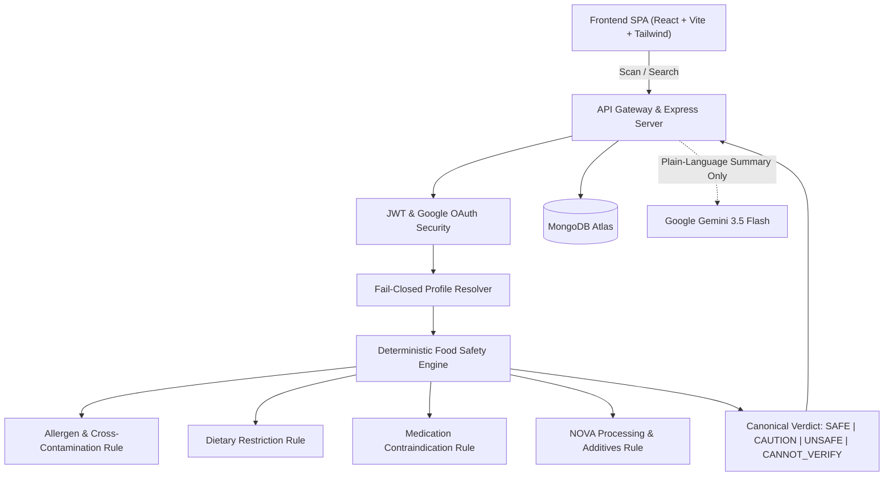

# NutriVibe

> **"Eat Smart. Stay Safe. Live Better."**

[](docs/FINAL_RELEASE_REPORT.md)
[](docs/FINAL_RELEASE_REPORT.md)
[](docs/FINAL_RELEASE_REPORT.md)
[](docs/SECURITY_AUDIT_REPORT.md)
[](LICENSE)
[](docs/DEPLOYMENT_VERIFICATION.md)

NutriVibe is an enterprise-grade, personalized food intelligence and health application. It converts real-time camera barcode scans, physical product packaging photographs (OCR), or search queries into instant, personalized, deterministic food safety evaluations. Rather than calculating generic nutrition ratings, NutriVibe evaluates products against **your specific health profile** — allergies, dietary restrictions, chronic conditions, and medications — or a dependent family profile (e.g., child, spouse, or elderly parent).

---

## 📸 Live Deployment & Portfolio Demo

- **Live Web Application**: [nutri-vibe-app-iota.vercel.app](https://nutri-vibe-app-iota.vercel.app/)
- **Quick Evaluation Guide**:
  1. Register an account and set an allergy profile (e.g., **Dairy** or **Peanuts**).
  2. Search or test barcode `4567890123456` (Greek Yogurt) to observe the deterministic **UNSAFE** safety verdict.
  3. Switch to a dependent family profile to observe instantaneous, fail-closed profile recalculation.

---

## ⚡ Core Capabilities

- **Deterministic Food Safety Engine (Sole Authority)**:
  - Canonical 4-verdict system: `SAFE`, `CAUTION`, `UNSAFE`, and `CANNOT_VERIFY`.
  - Fail-safe uncertainty mode: incomplete product data or unreadable OCR labels strictly yield `CANNOT_VERIFY`.
  - Drug-nutrient interaction checks (e.g., grapefruit + statins, vitamin K + warfarin, tyramine + MAOIs).
- **Dual-Mode Scanner**:
  - Live camera barcode/QR scanner (`html5-qrcode`).
  - Packaging OCR photo ingredient extractor (`Tesseract.js`) with manual review capabilities.
- **Family & Dependent Profile Switcher**:
  - IDOR-protected, fail-closed profile switching with zero risk of cross-account data leakage.
- **Personalized Plain-Language AI Explanations**:
  - Google Gemini 3.5 Flash provides educational, plain-English context.
  - Complete AI safety isolation: AI never decides or overrides deterministic safety verdicts.
- **Health Tracking & Analytics**:
  - Daily food log with Safe/Caution/Unsafe breakdowns.
  - Hydration logging, macronutrient/micronutrient tracking, and adverse reaction journal.
  - CSV report exports and historical food search.
- **External Public API (Phase 7 Option C)**:
  - Rate-limited API key authentication at `/v1/check` for external health apps and agents.

---

## 📐 System Architecture



---

## 🛠️ Technology Stack

- **Frontend**: React 18, Vite 6, JavaScript (ES Modules), Tailwind CSS, React Router v7, Axios, Lucide/Heroicons, Matter.js.
- **Backend**: Node.js, Express.js, MongoDB, Mongoose, JWT, Helmet, Express Rate Limit.
- **Caching**: Redis (with automatic in-memory fallback).
- **AI & Integrations**: Google Gemini API, Open Food Facts API, Google OAuth 2.0.
- **Quality Assurance**: Native Node.js Test Runner (`node --test`), ESLint.

---

## 🚀 Quick Start Guide

### Local Development (Without Docker)

#### 1. Backend Setup

```bash
cd server
npm install
```

Create a `.env` file in `server/`:

```env
PORT=5000
NODE_ENV=development
MONGO_URI=your_mongodb_connection_string
JWT_SECRET=your_super_secret_jwt_key_min_32_chars
CLIENT_URL=http://localhost:5173
GEMINI_API_KEY=your_gemini_api_key_optional
```

Start the backend:

```bash
npm run dev
```

#### 2. Frontend Setup

```bash
cd client
npm install
npm run dev
```

Open **[http://localhost:5173](http://localhost:5173)** in your browser.

---

### Local Development (With Docker Compose)

```bash
docker-compose up --build
```

This boots the client, server, MongoDB, and Redis instances concurrently.

---

## 🧪 Testing & Verification

Run the comprehensive test suites across both projects:

```bash
# Run backend tests (128 tests in 41 suites)
cd server
npm test

# Run canonical 14-mode safety engine verification
node --test tests/safetyEngineCanonical.test.js

# Run frontend unit tests (79 tests in 19 suites)
cd ../client
npm test

# Run safety benchmark evaluation (210 labeled test cases)
npm run eval

# Run frontend linting & static analysis
npm run lint

# Run production build
npm run build
```

---

## 📚 Engineering Documentation

| Document | Purpose |
| :--- | :--- |
| [docs/FINAL_RELEASE_REPORT.md](docs/FINAL_RELEASE_REPORT.md) | Final engineering sign-off, route inventory, defect resolutions |
| [docs/SECURITY_AUDIT_REPORT.md](docs/SECURITY_AUDIT_REPORT.md) | Threat modeling, attack surface mitigations, zero-vulnerability audit |
| [docs/TEST_RESULTS.md](docs/TEST_RESULTS.md) | Complete test logs (207 tests), safety verification, coverage analysis |
| [docs/DEPLOYMENT_VERIFICATION.md](docs/DEPLOYMENT_VERIFICATION.md) | Vercel & Render production procedures, health check API, rollbacks |
| [docs/ARCHITECTURE.md](docs/ARCHITECTURE.md) | Detailed data flow, database schemas, and request lifecycles |

---

## 📄 License

This project is licensed under the MIT License — see the [LICENSE](LICENSE) file for details.

## Environment Configuration

Ensure `server/.env` and `client/.env` are populated according to their `.env.example` templates. The server automatically resolves the local `.env` file even when executed from project subdirectories.
